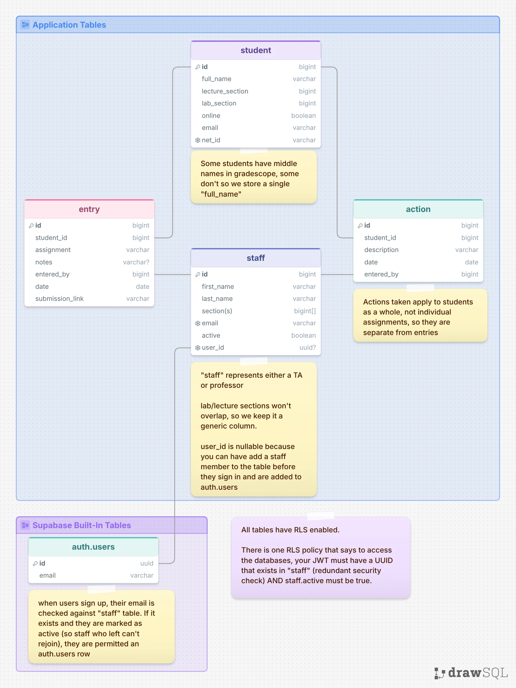
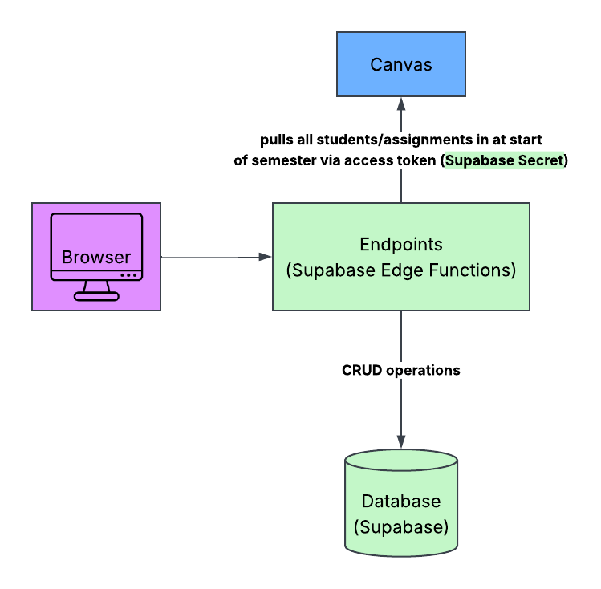

## Summary
This site is meant to be used by CS 110 TAs to keep track of AI use in students. When a student is caught or suspected of using AI to complete an assignment, TAs must record various information like the assignment, type of AI used (Code completion? Copy paste? Advanced concepts?), how many times they've used it in the past, and more. This helps keep the information centralized and easily accessible/interactable for all the TAs/professors using that information. 

## ERD

## Technologies Architecture

- Are we worried about concurrency/is it realistic for two TAs to be editing a student at once? When does data refresh for other TAs?

## Weekly Goals
- Week of Nov 16-20: 
    - [x] Finish ERD
    - [x] Finish architecture diagram
    - [x] Add tables to database
- Week of Nov 23-27:
    - [🦃] Be thankful
    - [ ] Create UI
    - [x] Add the manual stuff from the .sql scripts
    - [x] Manually insert the first staff member(s) (Jack and Lacy)
    - [x] Set up Google SMPT for magic links
    - [ ] Create CRUD endpoints (most queries should filter by current semester)
        - [x] Read all students
        - [x] Read one student by full name
            - [ ] Read all AI entries for one student
        - [x] Read all students for a given section
        - [x] Create student
        - [x] Update student
        - [x] Delete student
        - [x] Create semester
        - [x] Read semesters
        - [x] Update semester
        - [x] Delete semester (only works if not associated with any students)
        - [x] Create student action
        - [x] Update student action
          - [x] Test that you can't do this unless you were the staff member who made it
        - [ ] Delete student action
          - [ ] Test that you can't do this unless you were the staff member who made it
        - [ ] Create AI entry
        - [ ] Delete AI entry
          - [ ] Test that you can't do this unless you were the staff member who made it
        - [ ] Update AI entry
          - [ ] Test that you can't do this unless you were the staff member who made it
        - [x] Create staff member
        - [ ] Update staff member
        - [ ] Delete staff member (only works if not associated with any entries/actions, otherwise just update staff.active = False)
          - [ ] Test that setting active=False disallows a staff to sign in (takes 1 hour to refresh)
    - [ ] (OPTIONAL) Chrome extension that routes AI grades to the website automatically
    - [ ] (OPTIONAL) Add tables to define allowable homework assignments names (so you don't get nonmatching entries like 'Homework 3b' vs 'HW3B')
- Week of Nov 30 - Dec 4:
    - [ ] Do everything at once
    - [ ] Seed data and test
    - [ ] PRESENT ON DEC 2
    

## Info for presentation day
- What you learned
- What technologies were used
- Demo if possible

## Authentication Route
### Signing Up
When you get the extension/website (depending on how we end up doing it) you must sign in through OAuth (using your BYU email). An existing staff member adds you to the `staff` table with your email. When you attempt to sign in, it checks if the email you provided matches a row in `staff` and also checks that `staff.active` is true. This is so that old TAs (who still exist in `staff`) cannot rejoin after being removed. If that check returns true, it grants you a JWT that is saved in your browser and marks you as "authenticated", adds an entry for you in the supabase `auth.users` table, and updates `staff.user_id` to match `auth.users.id`. If your email is not approved, you are rejected and a row is NOT added to `auth.users`. 

### CRUD Operations
Every table has RLS activated, which denies any CRUD operations by default. RLS policies are what opens this up to conditionally grant access. Every time an API call is made to read or write the database, an RLS policy compares a UUID within your JWT against the ids in `auth.users`. 
