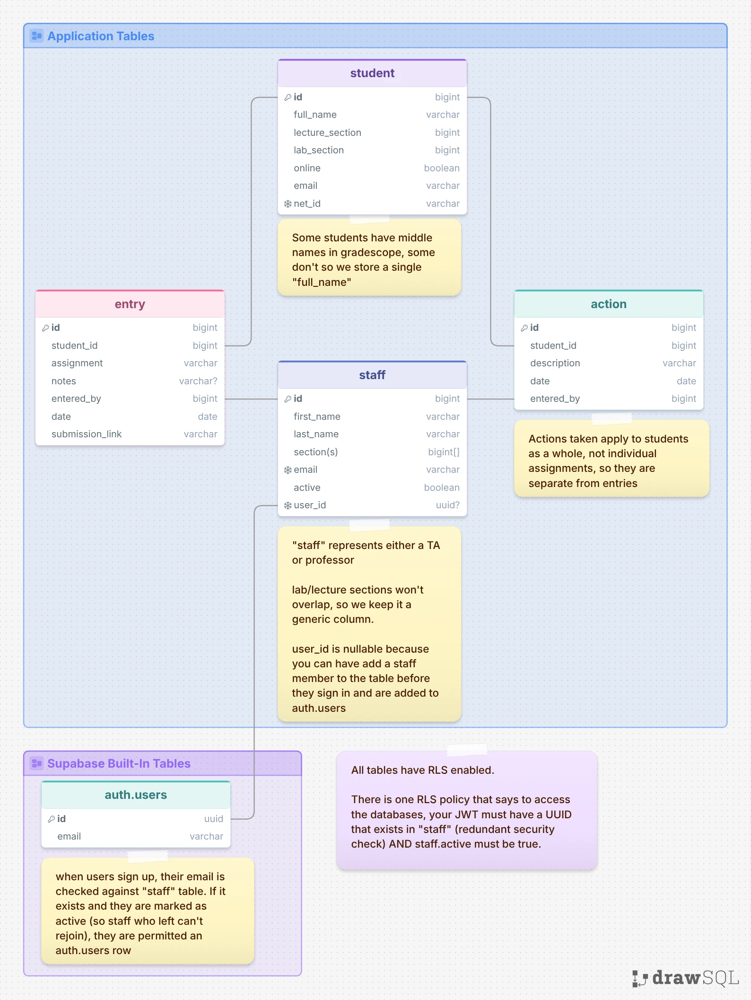

# Database

Postgres schema for the Supabase project.


## Files and run order

Run these **in this order**. Each depends on the one before it.

1. `schema.sql`: tables, indexes, and turning on RLS. Needs nothing.
2. `functions.sql`: `is_active_staff()`, the helper the policies use. Needs the tables.
3. `hooks.sql`: `reject_unlisted_signup`, the function behind the Supabase Auth sign-up hook. Needs the tables.
4. `triggers.sql`: the triggers that link a new login to its staff row and remove the login when staff are deactivated. Needs the tables.
5. `policies.sql`: the RLS policies that let active staff use the tables. Needs `is_active_staff()`.
6. `rpc/*.sql`: the API functions the app calls with `supabase.rpc(...)`, one file per operation. Need the tables and policies; independent of each other.

A **hook** is a function the Supabase Auth service calls at a set point in its own flow. A **trigger** is a function Postgres runs automatically when a row in a table is inserted, updated or deleted.

Why this order: everything refers to the tables, and the policies call `is_active_staff()`. Running them out of order fails with "relation/function does not exist". `hooks.sql` and `triggers.sql` only need the tables, so they can swap places with each other.

Each file is wrapped in its own transaction, so a failure rolls back only that file.

## How to run

**Option A: script** (runs every file above in order, including all of `rpc/`)

```
npm install pg
node scripts/apply-schema.mjs
```

- First set `PROJECT_REF` at the top of `scripts/apply-schema.mjs`. It is not a secret: it's the subdomain of your project URL (`https://<project-ref>.supabase.co`), also shown under Project Settings -> General.
- Run it from an interactive terminal. The script **prompts for the database password** with the input hidden, so it never goes into a file or your shell history. The password is the one you set when creating the project (reset it under Project Settings -> Database if you've forgotten it).
- It connects directly to `db.<project-ref>.supabase.co`, which is IPv6-only on most plans. If you get a connection error, change `DB_HOST` in the script to the "Session pooler" host from the dashboard (Connect), e.g. `aws-0-<region>.pooler.supabase.com`.

**Option B: Supabase SQL Editor.** Paste and run `schema.sql`, `functions.sql`, `hooks.sql`, `triggers.sql`, then `policies.sql`, then each file in `rpc/`.

## Manual steps (not in the SQL files)

1. **Enable the sign-up hook**, after running `hooks.sql`: Supabase dashboard -> Authentication -> Hooks -> *Before User Created* -> Postgres function -> `public.reject_unlisted_signup`. Until you do this, nothing blocks non-staff from creating an account. Their data access is still blocked by RLS, but the hook keeps `auth.users` clean.
2. **Add the first staff member**, after all five files have run (the commented insert at the bottom of `schema.sql`):
   ```sql
   insert into public.staff (first_name, last_name, email)
   values ('First', 'Last', 'someone@byu.edu');   -- email must be lowercase
   ```
   They can then sign in with Google, and add the rest of the staff.

## Re-running and changing the schema

- The files are safe to re-run on a project that already has **this** schema (`if not exists`, `create or replace`, `drop ... if exists`).
- They **do not migrate** an older version of the tables. `create table if not exists` skips a table that already exists, even if its columns differ. If you ran an earlier version (for example one with a `ta` table or join tables) and have no data to keep, drop the old tables first:
  ```sql
  drop table if exists public.student_entry, public.student_action,
    public.entry, public.action, public.staff, public.ta, public.student cascade;
  ```
  Do not do this on a project with real student data.

## How access works (summary)

- Every table has RLS on. With no matching policy, a role can read and write nothing.
- `policies.sql` lets a signed-in user (`authenticated` role) do anything on the tables only if `is_active_staff()` is true: their JWT's user id matches a `staff.user_id` row where `staff.active` is true.
- The `service_role` key and the direct DB connection bypass RLS. Keep both secret.
- Adding a staff row by email allows that person to sign in. On first sign-in, a trigger fills in `staff.user_id`.
- Setting `staff.active = false` removes the person's `auth.users` row (so they can't renew their login) but keeps the staff row, so past entries still show who made them. Staff are deactivated, never deleted: `entry.entered_by` and `action.entered_by` use `on delete restrict`, so you can't delete a `staff` row while there are still entries or actions associated with it.

## Not yet tested

None of this has been run against a real Supabase project. Things to verify when it is:
- The sign-up hook's return format (empty object to allow, `error` with `http_code` to reject) against Supabase's current docs.
- That the trigger on `auth.users` can be created by the `postgres` role the script connects as.
