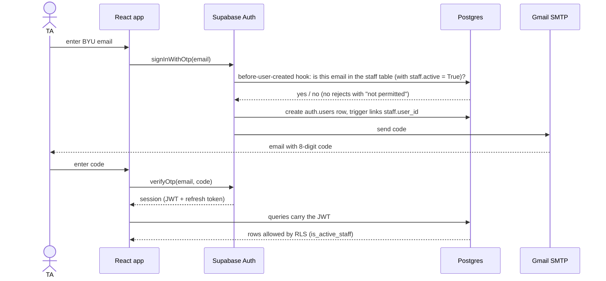

# Web app

React + TypeScript (Vite) front end for the AI Use Tracker. It talks directly to Supabase; there is no backend of our own.

To run you have to fill in VITE_SUPABASE_ANON_KEY in your own `.env` file
```
npm install
npm run dev            # http://localhost:5173
```

On Home, a student's Stats / History button opens a separate page with AI-use entry
and action counts across all semesters for their Net ID, along with the latest 50 of
each. Use Back to search or the browser's Back button to return to the search.

Assignment searches show a dashboard for each matching assignment, with a semester
selector and a list of students with recorded entries. Names differing only in
capitalization are grouped together. Each student is counted once per assignment
and semester, even if they have multiple entries. Actions and average grade are
shown as unavailable because actions are not tied to assignments and grades are
not stored.

In the Testing tab, create, update, and delete AI entries by searching for a student
by name and selecting the student. For updates and deletes, also select the entry.
Student options include the Net ID and semester to distinguish similar names.
These operations require the matching `create_entry`, `update_entry`, and
`delete_entry` SQL functions to be applied to Supabase (see `database/rpc/README.md`).
The database permits only an entry's author to update it; active staff may delete entries.

## How sign-in works

Only staff can use the site. Staff sign in with a one-time code emailed to their BYU address (no passwords).



Codes are sent from `cs110.aiflagtracker@gmail.com` and often land in Junk Email in Outlook.

