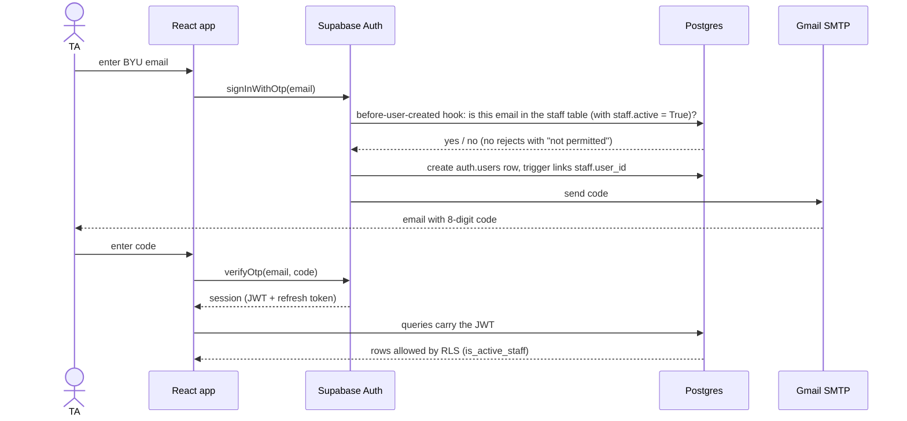

# Web app

React + TypeScript (Vite) front end for the AI Use Tracker. It talks directly to Supabase; there is no backend of our own.

To run you have to fill in VITE_SUPABASE_ANON_KEY in your own `.env` file
```
npm install
npm run dev            # http://localhost:5173
```

## How sign-in works

Only staff can use the site. Staff sign in with a one-time code emailed to their BYU address (no passwords).



Codes are sent from `cs110.aiflagtracker@gmail.com` and often land in Junk Email in Outlook.

